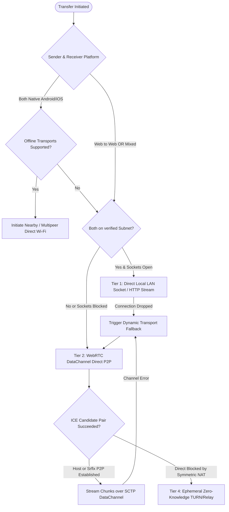

# PORTALLINK — PLATFORM CAPABILITIES & HARDWARE MATRIX
**Version:** 1.0.0-PROD  
**Author:** Principal Platform Engineer  
**Scope:** Browser (Web), Android Native, iOS Native, Desktop  

---

## 1. Truthful Platform Matrix

PortalLink adheres strictly to a **zero-fabrication policy**. Rather than claiming universal hardware capabilities across all platforms, PortalLink documents and enforces real platform capabilities, handling missing APIs through graceful, transparent fallbacks.

| Capability / Subsystem | Modern Browsers (Chrome / Edge / Firefox / Safari) | Native Android (API 29+) | Native iOS (iOS 15+) | Desktop (Electron / Tauri / Node) |
|---|---|---|---|---|
| **WebRTC DataChannels** | Supported natively (DTLS/SCTP) | Supported via WebRTC library | Supported via WebRTC library | Supported natively |
| **Local Subnet LAN Discovery** | Blocked by W3C (No raw UDP/mDNS) | Supported (mDNS / NSD / Multicast) | Supported (Bonjour / NWBrowser) | Supported (Node.js dgram / mdns) |
| **Silent Device Scanning** | Strictly Impossible (Security sandbox) | Supported (Nearby Connections / BLE) | Supported (BLE / Multipeer) | Supported (Local interface scans) |
| **Physical Touch / Near-Touch Detection**| Impossible (Simulated proximity blocked) | Supported (NFC / Ultra-Wideband) | Supported (CoreNFC / UWB on U1/U2) | Impossible (Unless dedicated peripheral) |
| **Wi-Fi Direct / Offline Hotspot** | Strictly Impossible | Supported (WifiP2pManager) | Restricted (Wi-Fi Aware where enabled) | Supported (Hostapd / Win32 APIs) |
| **Background Transfer Execution** | Limited (ServiceWorker / BackgroundFetch) | Supported (Foreground Service + Notification) | Supported (NSURLSession Background) | Supported (Native background thread) |
| **Direct File System Streaming** | Supported (File System Access API) | Supported (SAF / Scoped Storage) | Supported (Security Scoped Bookmarks) | Supported (Native OS Filesystem) |
| **Battery Level Reporting** | Deprecated / Chrome only (Battery API) | Supported (BatteryManager API) | Supported (UIDevice.batteryLevel) | Supported (OS Power APIs) |
| **Clipboard Sharing** | Explicit User Permission (`navigator.clipboard`)| Supported (ClipboardManager) | Supported (UIPasteboard) | Supported (Full OS access) |
| **Screen / Window Sharing** | Supported (`getDisplayMedia`) | Supported (MediaProjection API) | Supported (ReplayKit / Broadcast Upload) | Supported (DesktopCapturer) |

---

## 2. Web Browser Implementation Realities & Fallbacks

### 2.1 The Browser Discovery Reality
- **Constraint:** Web browsers cannot silently listen for raw UDP multicast, broadcast beacons, or arbitrary local network ARP packets due to browser sandboxing and privacy restrictions.
- **PortalLink Solution:** Discovery in web browsers operates via the **Web Presence Provider** connected to an ephemeral signaling gateway. When PortalLink is loaded and the user enables availability, the browser registers an ephemeral session token with the presence registry. Devices on the same public IP / subnet hash or participating in the same **Portal Room** discover each other instantly.
- **Bluetooth Constraint:** Web Bluetooth requires an explicit browser user-permission prompt and requires compatible custom GATT service UUIDs. PortalLink will NEVER pop up an annoying browser Bluetooth selection prompt as the default experience.

### 2.2 Streaming File Access & Memory Bounding
- **Browser Feature:** On Chromium browsers (Chrome, Edge), PortalLink utilizes the `showSaveFilePicker()` and `FileSystemWritableFileStream` to pipe received binary chunks directly to the physical disk without caching gigabytes in RAM.
- **Safari / Firefox Fallback:** Where `FileSystemWritableFileStream` is unavailable, PortalLink buffers chunks into memory-managed `Blob` segments with bounded buffer pools, or creates download objects cleanly upon transfer completion.

---

## 3. Native Android Architecture (`apps/android`)

### 3.1 Android Nearby Connections
- **API:** `com.google.android.gms.nearby.connection.ConnectionsClient`
- **Strategy:** `Strategy.P2P_STAR` (for 1-to-many broadcast) and `Strategy.P2P_CLUSTER` (for mesh discovery).
- **Transport:** Automatically negotiates high-speed Wi-Fi Direct or local hotspot without requiring cellular data or shared Wi-Fi router.
- **Payload Streaming:** Employs `Payload.fromStream()` for unbounded file streaming.

### 3.2 Background Resilience
- Employs an ongoing `ForegroundService` with notification priority `PRIORITY_LOW` displaying transfer velocity and real-time byte progress, preventing Android OS Doze mode from killing active transfers.

---

## 4. Native iOS Architecture (`apps/ios`)

### 4.1 Apple MultipeerConnectivity & Network.framework
- **Multipeer Framework:** `MCSession`, `MCNearbyServiceAdvertiser`, and `MCNearbyServiceBrowser` provide zero-configuration offline discovery and transfer between Apple devices with service type `portallink-share`.
- **Modern Network.framework:** `NWBrowser` and `NWListener` using TLS and Bonjour (`_portallink._tcp`) for low-latency LAN socket streaming.

### 4.2 Security Scoped Bookmarks
- Utilizes `UIDocumentPickerViewController` and `startAccessingSecurityScopedResource()` for sandbox-compliant file read/write.

---

## 5. Intelligent Transport Engine (ITE) Decision Tree

