# PORTALLINK — PRODUCT ARCHITECTURE SPECIFICATION
**Version:** 1.0.0-PROD  
**Author:** Principal System Architect  
**Classification:** Core System Architecture Document  

---

## 1. Executive Overview

**PortalLink** is a production-grade, cross-platform spatial file-sharing and device collaboration ecosystem. Moving away from traditional cloud-storage intermediaries or rigid pairing utilities, PortalLink introduces a **spatial-computing-inspired interaction model** centered around an intelligent dynamic portal. Digital payloads (files, streams, clipboard items, and presentation links) are transferred directly peer-to-peer using an **Intelligent Transport Engine (ITE)** that dynamically evaluates device compatibility, local network availability, latency, and throughput to route data over WebRTC DataChannels, local network sockets, or native peer-to-peer transports (Android Nearby Connections / Apple Network Framework).

```
                      +-----------------------------+
                      |   PORTALLINK SPATIAL UI     |
                      | (Spatial Portal, Rings, UI) |
                      +--------------+--------------+
                                     |
               +---------------------+---------------------+
               |                                           |
+--------------v---------------+             +-------------v--------------+
|   DISCOVERY ENGINE           |             |    TRANSFER ENGINE         |
| - Web Presence Provider      |             | - Chunking (64KB - 1MB)    |
| - Local LAN Provider (mDNS)  |             | - Stream Backpressure      |
| - Native P2P Discovery       |             | - SHA-256 Checksums        |
+--------------+---------------+             | - Pause / Resume Recovery  |
               |                             +-------------+--------------+
               |                                           |
+--------------v-------------------------------------------v--------------+
|                   INTELLIGENT TRANSPORT ENGINE (ITE)                    |
| - WebRTC DataChannel (Direct P2P via STUN / TURN)                       |
| - Local Network Transport (Direct LAN HTTP/WebSocket Sockets)           |
| - Native Offline Transports (Nearby / Wi-Fi Direct / Wi-Fi Aware)       |
| - Automatic Fallback & Dynamic Routing                                  |
+-------------------------------------------------------------------------+
                                     |
+------------------------------------v------------------------------------+
|                    CRYPTOGRAPHIC & SECURITY LAYER                       |
| - Ephemeral Curve25519 / ECDH Key Exchange                              |
| - AES-GCM-256 Payload Framing & WebRTC DTLS-SRTP                        |
| - One-Time 6-Digit CSPRNG PIN Authorization                             |
| - Session-Bound QR Invitations & Gesture Challenge-Response             |
+-------------------------------------------------------------------------+
```

---

## 2. Core Subsystems & Decomposition

### 2.1 Spatial Interaction & UI Layer (`apps/web` & `packages/ui`)
- **Central Dynamic Spatial Portal:** A 14-state interactive visual engine featuring dynamic SVG/Canvas rings, energy particle emitters, gravitational drag attraction, and contextual illumination.
- **Spatial Device Universe:** Real-time spatial radar displaying authenticated, active participating devices with dynamic radial positioning, device category geometry, and verified telemetry (battery, transport capability, latency).
- **File Capsule Matrix:** Non-blocking drag-and-drop ingestion with MIME inspection, file checksum preview, memory-bounded batching, and per-target dispatch.

### 2.2 Intelligent Device Discovery Engine (`packages/discovery`)
- **Common Device Model:** Normalized schema across Web, Desktop, Android, and iOS.
- **Provider Abstraction:**
  1. *Web Presence Provider:* Ephemeral WebSocket/SSE signaling with heartbeat-backed TTL (15s heartbeat, 45s eviction).
  2. *LAN Discovery Provider:* Subnet broadcast / mDNS discovery on local Wi-Fi networks where accessible.
  3. *Native Android Discovery Provider:* Google Play Services Nearby Connections API (Strategy: P2P_CLUSTER or P2P_STAR) and Wi-Fi Direct service discovery.
  4. *Native iOS Discovery Provider:* MultipeerConnectivity & Apple Network.framework (NWBrowser / NWListener with Bonjour service `_portallink._tcp`).
- **Zero Fabrication Guarantee:** No simulated or hardcoded nearby devices. Devices appear only upon verified beacon receipt.

### 2.3 Intelligent Transport Engine (ITE) (`packages/transport`)
The ITE continuously measures network conditions and negotiates the optimal transport channel:
1. **Tier 1 — Direct LAN Socket (High Throughput / Low Latency):** If sender and receiver share a verified subnet and local ports are reachable, stream directly over local HTTP/2 or WebSocket streams (up to 100+ MB/s).
2. **Tier 2 — WebRTC DataChannel (Internet P2P):** Utilizes standard ICE gathering (STUN: `stun.l.google.com:19302`) with DTLS 1.3 / SCTP data channels for end-to-end encrypted direct mesh streaming across NATs.
3. **Tier 3 — Native Wi-Fi Direct / Wi-Fi Aware (Offline P2P):** On Android/iOS hardware, negotiates offline direct wireless connections without access points.
4. **Tier 4 — Authenticated Secure Relay Fallback:** If symmetric NAT / firewall prevents direct P2P and local LAN is blocked, route end-to-end encrypted chunks through an ephemeral TURN or zero-knowledge relay buffer.

### 2.4 Streaming Transfer Engine (`packages/transfer`)
- **Memory Bounded Streaming:** Files are sliced into bounded chunks (configurable 64 KB for high-latency WebRTC; 1 MB for local high-throughput LAN). Files larger than memory capacity (e.g., 10 GB+) stream directly through the browser `ReadableStream` / `FileSystemWritableFileStream` without holding the entire buffer in RAM.
- **Backpressure Regulation:** SCTP buffered amount monitoring (`bufferedAmountLowThreshold`) prevents browser buffer overflow and dropped frames.
- **Cryptographic Verification:** Sender computes a rolling SHA-256 hash or chunk-level Merkle tree. The receiver verifies chunk integrity upon ingestion and validates the overall digest prior to finalizing the local file save.
- **State Machine:** Deterministic state machine supporting `QUEUED`, `OFFERED`, `AUTHORIZING`, `CONNECTING`, `TRANSFERRING`, `PAUSED`, `RESUMING`, `COMPLETED`, `CANCELLED`, `FAILED`.

### 2.5 Security, Pairing, and Authorization (`packages/crypto` & `packages/pairing`)
- **One-Time Transfer PIN:** 6-digit numeric code generated strictly using `crypto.getRandomValues()` (never `Math.random()`), bound to an ephemeral 5-minute session UUID with a maximum of 3 verification attempts.
- **Session-Bound QR Invitations:** QR payloads contain an ephemeral URL containing the session ID and a high-entropy one-time key fragment (`#token=...`), ensuring that scanning the code directly establishes signaling without leaking authorization secrets over public logs.
- **PortalLink Instant (Gesture Sharing):** Dynamic 2D geometric vector matching utilizing normalized coordinate quantization and challenge-response signature hashing.
- **Zero-Trust Transfer Authorization:** Receiver must explicitly approve transfers; no silent automatic saves.

---

## 3. Monorepo Repository Structure

```
PortalLink/
├── apps/
│   ├── web/                     # Production Next.js 14+ / React Spatial Web Application
│   │   ├── app/                 # App Router (Home, Rooms, Transfer, Diagnostics, QR, Instant)
│   │   ├── components/          # Spatial Portal, Device Nodes, File Capsules, PIN Modals
│   │   ├── hooks/               # useDiscovery, useTransfer, useWebRTC, usePortalAnimation
│   │   └── public/              # Static SVG symbols, sound effects, PWA manifests
│   ├── android/                 # Native Kotlin PortalLink Android Client
│   │   └── app/src/main/kotlin/ # Nearby Connections & Wi-Fi Direct Native Adapters
│   └── ios/                     # Native Swift PortalLink iOS Client
│       └── PortalLink/          # MultipeerConnectivity & Network.framework Adapters
├── packages/
│   ├── core/                    # Core interfaces, DeviceModel, TransferSession schemas
│   ├── protocol/                # Binary & JSON Wire protocol, MessageEnvelopes, Framing
│   ├── crypto/                  # WebCrypto abstractions, CSPRNG PIN, SHA-256 streaming hasher
│   ├── discovery/               # Discovery Provider interfaces & implementations
│   ├── pairing/                 # PIN authorization, QR token lifecycle, Gesture matcher
│   ├── transport/               # ITE engine, WebRTC manager, LAN socket manager
│   ├── transfer/                # Chunk slicer, backpressure pipe, pause/resume registry
│   └── ui/                      # Design system tokens, glassmorphism utilities, audio triggers
├── services/
│   ├── signaling/               # Ephemeral WebRTC signaling gateway (Node.js/WebSocket)
│   └── presence/                # Real-time device discovery registry with heartbeat TTL
├── docs/                        # Authoritative documentation suite
│   ├── PRODUCT_ARCHITECTURE.md
│   ├── DESIGN_SYSTEM.md
│   ├── PLATFORM_CAPABILITIES.md
│   ├── SECURITY_MODEL.md
│   ├── IMPLEMENTATION_ROADMAP.md
│   └── FEATURE_STATUS.md
├── package.json                 # Monorepo root configuration & orchestration scripts
├── tsconfig.json                # Shared TypeScript compiler options
└── README.md                    # Project documentation
```

---

## 4. End-to-End Transfer Lifecycle

```mermaid
sequenceDiagram
    autonumber
    actor Sender as Sender Device
    participant UI as Spatial Portal
    participant Disc as Discovery Service
    participant Sig as Signaling / Relay
    participant ITE as Transport Engine (ITE)
    actor Receiver as Receiver Device

    Sender->>UI: Drops File Capsule into Central Portal
    UI->>UI: Inspects MIME, calculates file size & SHA-256 chunk matrix
    Sender->>UI: Selects Target Receiver Node
    UI->>ITE: Request optimal transport evaluation
    ITE->>Sig: Initiate Transfer Session (SessionID, Metadata, TransportCandidates)
    Sig->>Receiver: Forward Incoming Transfer Notification
    Receiver->>Receiver: Displays Incoming File Sheet (Name, Size, Sender ID)
    
    rect rgb(20, 25, 45)
    Note over Sender,Receiver: Security Authorization (6-Digit PIN or QR / Gesture)
    Sender->>Sender: Generate CSPRNG 6-Digit PIN (Valid: 300s, Max Attempts: 3)
    Sender-->>Receiver: Out-of-band PIN verbalization OR QR Scan
    Receiver->>Sig: Submit Authorization Proof (HMAC / PIN Digest)
    Sig->>Sender: Proof Verified -> Session Authorized
    end

    rect rgb(15, 35, 30)
    Note over Sender,Receiver: Data Streaming & Verification
    Sender->>Receiver: Open WebRTC DataChannel or Direct LAN Socket
    loop Chunk Streaming with Backpressure
        Sender->>Receiver: Binary Chunk [ChunkIndex, TotalChunks, Payload, ChunkChecksum]
        Receiver->>Receiver: Write to FileStream & Accumulate Merkle Digest
        Receiver-->>Sender: ACK [ChunkIndex, BytesReceived]
    end
    Sender->>Receiver: Finalize Transfer [Final SHA-256 Digest]
    Receiver->>Receiver: Match Final SHA-256 vs Calculated Checksum
    Receiver-->>Sender: Transfer Verified & Saved
    end

    UI->>Sender: Portal produces Complete Ring Bloom Animation
    Receiver->>Receiver: Display File Ready & In-App Preview
```



---

## 5. Architectural Quality Attributes

1. **Memory Efficiency:** Streaming chunks are garbage collected immediately after transmission; memory consumption remains `< 50 MB` regardless of transferred file size (verified on multi-gigabyte payloads).
2. **Deterministic Security:** All cryptographic operations rely on standard audited primitives (`WebCrypto API`, `SubtleCrypto`, `AES-GCM-256`, `SHA-256`).
3. **Resilience & Fallback:** Transport drops trigger immediate reconnection routines with resume headers (`ByteOffset`) rather than restarting transfers from byte 0.
4. **Honest Observability:** Progress bars and speedometers calculate velocity from acknowledged receiver bytes, completely eliminating simulated or fabricated UI metrics.
